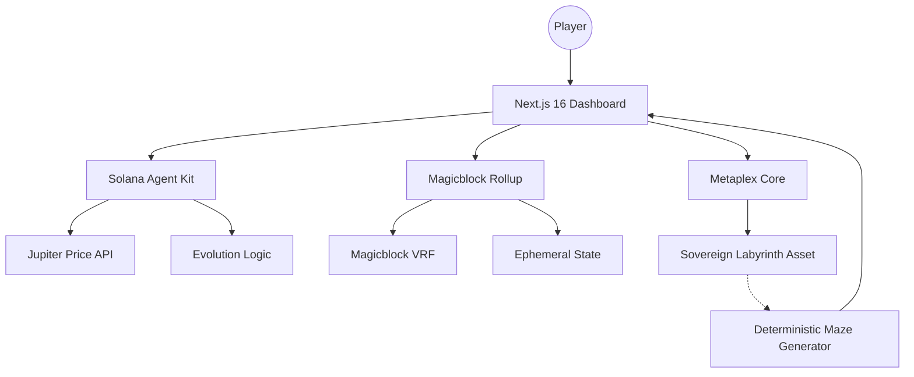

# ORIM: Gamified DeFi Labyrinth

**Project Description:**
ORIM is a "Gamified DeFi" project built on Solana. It serves as an interactive front-end for Flash Trade V2 disguised as an endless labyrinth game. Players take a Long or Short position on crypto assets before entering the maze. Real-time market volatility dynamically triggers in-game traps, and the final leaderboard ranking is determined by combining the player's escape time with their trading PnL.

---

## The Vision: Sovereign Autonomous Worlds
In ORIM, the labyrinth isn't just a static level, it's a Sovereign Agent. Each maze is minted as a Metaplex Core Asset, serving as a container for its own rules, rewards, and evolution logic. As a Divine Architect, you don't just play the game; you summon and manage living dungeons that breathe alongside the Solana market pulse.

---

## Key Features

### Divine Architect Dashboard
A premium command center for creators to manage their on-chain assets.
- Atomic Summoning: Mint a Metaplex Core Asset and its associated Fungible Token (Energy) in a single, seamless transaction.
- Market Pulse Sync: Synchronize your labyrinth with the real-world Solana market. The labyrinth's Mood (Radiant, Void, Cyber) evolves based on live SOL price data.
- Architectural Evolution: AI-driven inference (via Solana Agent Kit) determines the architectural shift, changing the palette and difficulty of the game world.

### Magicblock Performance Engine
**How ORIM uses the Ephemeral Rollup:**
ORIM uses MagicBlock Ephemeral Rollups to achieve zero-latency gaming with on-chain composability. Maze navigation requires high-frequency keystrokes, which would cause severe lag and gas costs if processed directly on Layer 1. By delegating the active game state to the Ephemeral Rollup, all movements are processed instantly for free. Only the final cleared state and PnL score are seamlessly committed back to the Solana Mainnet.
- **Magicblock VRF:** Ensures fair and tamper-proof randomness for the on-chain Infinite Maze mode, guaranteeing that every procedural layout is both unique and verified.

### Dual-Tab Discovery System
A community-driven navigation hub for all labyrinth types.
- SOLO CAMPAIGN: 100+ handcrafted sequential stages across multiple Worlds (Pixel Forest, Crystal Cave, etc.).
- COMMUNITY LABYRINTHS: A global discovery tab where you can explore and play unique labyrinths summoned by other users.
- Real-Time Clear Tracking: Every community labyrinth displays functional Play Counts which increment persistently as players clear them on-chain.

### Sovereign Gameplay Engine
- Deterministic Generation: Sovereign mazes derive their layout directly from their Solana Address. This means every asset is a unique, permanent world.
- Retro-Cyber Aesthetics: High-fidelity pixel art combined with modern glassmorphism and dynamic CRT scanline effects.

---

## Bounty and Technical Implementation

ORIM leverages cutting-edge Solana infrastructure to achieve true autonomy. Below are the key technical integrations with direct links to the implementation:

### 1. Metaplex Core (The Living Asset Standard)
We chose Metaplex Core for its efficiency and plugin-based extensibility. Every labyrinth is a Core Asset, allowing for cheap metadata updates and autonomous state management.
- Implementation: [src/lib/blockchain/maze-agent-service.ts](https://github.com/Joseph-hackathon/Orim/blob/main/src/lib/blockchain/maze-agent-service.ts)
- Key Logic: summonLabyrinth combines Asset creation and Token minting into a single atomic ritual.

### 2. Magicblock (High-Speed Autonomous Infrastructure)
Magicblock provides the performance layer required for a high-fidelity Web3 game.
- Implementation: [src/app/game/[stage]/page.tsx](https://github.com/Joseph-hackathon/Orim/blob/main/src/app/game/%5Bstage%5D/page.tsx)
- Key Tech: Integration of Ephemeral Rollups for session-based state management and Magicblock VRF for secure procedural generation.

### 3. Solana Agent Kit (The Autonomous Mind)
The Solana Agent Kit powers our Architect AI. It evaluates market conditions and manages the evolution logic of the labyrinths.
- Implementation: [src/lib/blockchain/maze-agent-service.ts](https://github.com/Joseph-hackathon/Orim/blob/main/src/lib/blockchain/maze-agent-service.ts)
- Key Logic: evolveMaze uses the Agent Kit to infer architectural shifts and recordLabyrinthClear handles the autonomous recording of player progress.

### 4. Sovereign Procedural Generation
Our engine ensures that "The Code is the World".
- Implementation: [src/lib/maze/generator.ts](https://github.com/Joseph-hackathon/Orim/blob/main/src/lib/maze/generator.ts)
- Key Logic: generateSovereignMaze uses a deterministic seed derived from the Solana PublicKey to ensure a permanent, unique layout for every minted asset.

---

## System Architecture



---

## Retention and Economy
- Architect Rank: Progress through ranks by summoning and evolving labyrinths.
- Dynamic Rewards: Multiplier bonuses when the market is "Radiant".
- Social Proof: Real-time "Plays" tracking for community creations encourages creators to design more engaging (or difficult) mazes.

---

## Getting Started

```bash
# 1. Clone the repository
git clone https://github.com/Joseph-hackathon/Orim.git

# 2. Install dependencies
npm install

# 3. Configure Environment
# Add your NEXT_PUBLIC_SOLANA_RPC and OPENAI_API_KEY to .env

# 4. Launch the Ecosystem
npm run dev
```

---

ORIM — Forge the path. Evolve the world. The Labyrinth is ALIVE.
