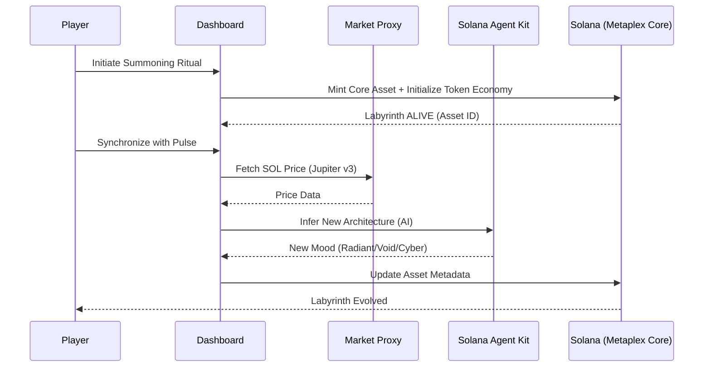
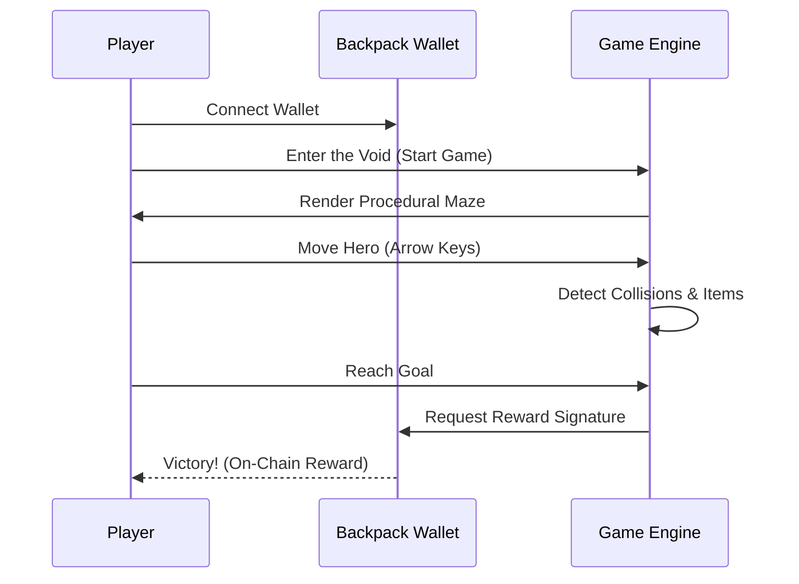

# ORIM — The Eternal Labyrinth 🏛️✨

**ORIM** is a high-fidelity, Web3-native pixel art adventure where players navigate a living, breathing labyrinth that possesses its own sovereign identity and economic soul. Powered by **Metaplex Core** and the **Solana Agent Kit**, ORIM transitions the traditional maze game into an autonomous ecosystem where the world itself reacts to the pulse of the real-world market.

---

## 🌌 Overview
In ORIM, the labyrinth isn't just a static stage—it's a **Sovereign Agent**. Each maze is minted as a Metaplex Core Asset, serving as a container for its own rules, rewards, and evolution logic. As the "Divine Architect," you don't just play the game; you summon and manage living dungeons that "breathe" alongside the Solana market.

---

## 🎨 Game Features
- **Sovereign Labyrinths**: Every maze is an independent entity on-chain with its own metadata and economic state.
- **Retro-Cyber Aesthetic**: High-fidelity pixel art combined with modern "One-Piece" dashboard design and glassmorphism.
- **Market-Driven Evolution**: The world's "Mood" and "Architecture" shift in real-time based on the price of $SOL.
- **Atomic Rituals**: Seamless user experience where summoning and economic setup happen in a single, bundled transaction.

---

## 🛠️ Key Features (Technical)
- **Metaplex Core Integration**: Utilizing the next-generation NFT standard for low-cost, high-performance autonomous assets.
- **Autonomous Architect (AI)**: Integrated **Solana Agent Kit** to handle complex on-chain decision-making and asset evolution.
- **Market Pulse Sync**: Real-time synchronization with **Jupiter Price API v3** to drive the labyrinth's mood engine.
- **Memoized Blockchain Services**: Performance-optimized UI that handles heavy SDK initializations with near-zero latency.

---

## 🎮 Why it's Fun
1. **Dynamic Challenge**: The maze you played yesterday might be completely different today if the market moves. A "Radiant" maze in a bull market is more complex and rewarding, while a "Void" maze in a bear market is atmospheric and dangerous.
2. **True Ownership**: You don't just own a skin; you own a piece of the game's world-logic.
3. **Emergent Strategy**: Players must adapt their movement and resource management based on the current "Mood" of the labyrinth.

---

## ⚙️ System Flow


---

## 👤 User Flow


---

## 🏆 Bounty Integration
1. **Metaplex Core**: Used as the foundational layer for "Living Mazes," allowing for efficient metadata updates and autonomous ownership structures.
2. **Solana Agent Kit**: Empowered the "Divine Architect" dashboard, enabling AI-driven evolution of the game world based on external data.
3. **Jupiter API**: Integrated real-time market data to act as the "heartbeat" of the game's ecosystem.

---

## 📈 Retention Strategy
- **Architect Progression**: Players can level up their "Architect Rank" by summoning and evolving more complex labyrinths.
- **Daily Market Rewards**: Special rewards that trigger only when the labyrinth enters a specific state (e.g., "Gilded Ascension" bonuses during SOL pumps).
- **Customizable Heroes**: Use on-chain items earned in the maze to customize your chibi hero, driving a long-term collection loop.
- **Social Echo**: High-score boards for each "Mood" state, encouraging players to master the labyrinth in all its forms.

---

## 🚀 Getting Started

```bash
# Clone the repository
git clone https://github.com/Joseph-hackathon/Orim.git

# Install dependencies
npm install

# Run the dev server
npm run dev
```

**ORIM — Forge the path. Evolve the world.**
