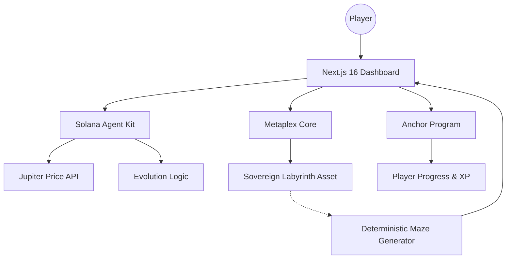

# ORIM — Autonomous Labyrinth Ecosystem 🏛️✨

**ORIM** is a high-fidelity, Web3-native autonomous game ecosystem where players navigate a living, breathing labyrinth that possesses its own sovereign identity and economic soul. Powered by **Metaplex Core** and the **Solana Agent Kit**, ORIM transitions the traditional maze game into an autonomous world where the environment itself reacts to the pulse of the real-world market.

---

## 🌌 The Vision: Sovereign Autonomous Worlds
In ORIM, the labyrinth isn't just a static level—it's a **Sovereign Agent**. Each maze is minted as a Metaplex Core Asset, serving as a container for its own rules, rewards, and evolution logic. As a "Divine Architect," you don't just play the game; you summon and manage living dungeons that "breathe" alongside the Solana market pulse.

---

## 🎨 Key Features

### 🏛️ Divine Architect Dashboard
A premium command center for creators to manage their on-chain assets.
- **Atomic Summoning**: Mint a Metaplex Core Asset and its associated Fungible Token (Energy) in a single, seamless transaction.
- **Market Pulse Sync**: Synchronize your labyrinth with the real-world Solana market. The labyrinth's "Mood" (Radiant, Void, Cyber) evolves based on live SOL price data.
- **Architectural Evolution**: AI-driven inference (via Solana Agent Kit) determines the architectural shift, changing the palette and difficulty of the game world.

### 🌎 Dual-Tab Discovery System
A community-driven navigation hub for all labyrinth types.
- **SOLO CAMPAIGN**: 100+ handcrafted sequential stages across multiple "Worlds" (Pixel Forest, Crystal Cave, etc.).
- **COMMUNITY LABYRINTHS**: A global discovery tab where you can explore and play unique labyrinths summoned by other users.
- **Real-Time Clear Tracking**: Every community labyrinth displays functional "Play Counts" (👤) which increment persistently as players clear them on-chain.

### 🎮 Sovereign Gameplay Engine
- **Deterministic Generation**: Sovereign mazes derive their layout directly from their Solana Address. This means every asset *is* a unique, permanent world.
- **Retro-Cyber Aesthetics**: High-fidelity pixel art combined with modern glassmorphism and dynamic CRT scanline effects.
- **Autonomous Rewards**: (Upcoming) Real-time token distribution based on player performance scores evaluated by AI.

---

## 🏆 Bounty & Technical Implementation

ORIM leverages cutting-edge Solana infrastructure to achieve true autonomy. Below are the key technical integrations with direct links to the implementation:

### 1. Metaplex Core (The Living Asset Standard)
We chose **Metaplex Core** for its efficiency and plugin-based extensibility. Every labyrinth is a Core Asset, allowing for cheap metadata updates and autonomous state management.
- **Implementation**: [src/lib/blockchain/maze-agent-service.ts](https://github.com/Joseph-hackathon/Orim/blob/main/src/lib/blockchain/maze-agent-service.ts)
- **Key Logic**: `summonLabyrinth` combines Asset creation and Token minting into a single atomic ritual.

### 2. Solana Agent Kit (The Autonomous Mind)
The **Solana Agent Kit** powers our "Architect AI". It evaluates market conditions and manages the evolution logic of the labyrinths.
- **Implementation**: [src/lib/blockchain/maze-agent-service.ts](https://github.com/Joseph-hackathon/Orim/blob/main/src/lib/blockchain/maze-agent-service.ts)
- **Key Logic**: `evolveMaze` uses the Agent Kit to infer architectural shifts and `recordLabyrinthClear` handles the autonomous recording of player progress.

### 3. Sovereign Procedural Generation
Our engine ensures that "The Code is the World".
- **Implementation**: [src/lib/maze/generator.ts](https://github.com/Joseph-hackathon/Orim/blob/main/src/lib/maze/generator.ts)
- **Key Logic**: `generateSovereignMaze` uses a deterministic seed derived from the Solana PublicKey to ensure a permanent, unique layout for every minted asset.

### 4. Custom Anchor Program
We built a custom Solana program to handle persistent player profiles and verified stage clears.
- **IDL**: [src/lib/blockchain/idl.json](https://github.com/Joseph-hackathon/Orim/blob/main/src/lib/blockchain/idl.json)
- **Frontend Integration**: [src/lib/blockchain/program-service.ts](https://github.com/Joseph-hackathon/Orim/blob/main/src/lib/blockchain/program-service.ts)

---

## ⚙️ System Architecture



---

## 🚀 Retention & Economy
- **Architect Rank**: Progress through ranks by summoning and evolving labyrinths.
- **Dynamic Rewards**: Multiplier bonuses when the market is "Radiant".
- **Social Proof**: Real-time "Plays" tracking for community creations encourages creators to design more engaging (or difficult) mazes.

---

## 🛠️ Getting Started

```bash
# 1. Clone the repository
git clone https://github.com/Joseph-hackathon/Orim.git

# 2. Install dependencies
npm install

# 3. Configure Environment
# Add your NEXT_PUBLIC_SOLANA_RPC and OPENAI_API_KEY to .env

# 4. Launch the Ecosystem
npm run dev
```

---

**ORIM — Forge the path. Evolve the world. The Labyrinth is ALIVE.** 🏛️✨
